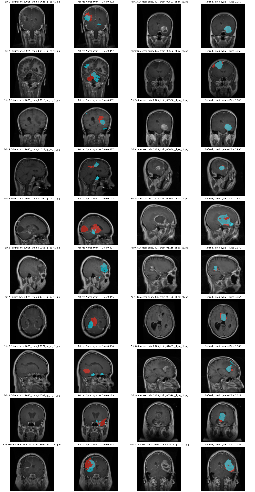

# Matched glioma case study

Ten failure/success pairs were selected without replacement before visual interpretation. Reference areas differ by at most 20%; identical orientation was preferred, followed by minimum absolute log area ratio and normalized-path tie-breaking. Red is reference and cyan is prediction.

## Pair 1

The failure (`brisc2025_train_00425_gl_co_t1.jpg`, Dice 0.482) and success (`brisc2025_train_00503_gl_co_t1.jpg`, Dice 0.957) have reference areas of 327 and 327 pixels. The failure prediction has 2 components and a prediction/reference area ratio of 0.78; the success has 1 components and ratio 1.05. Its centroid error is 6.1 pixels larger than the matched success. This pair supports a localization/topology explanation only; it does not establish a clinical imaging cause.

## Pair 2

The failure (`brisc2025_train_00510_gl_co_t1.jpg`, Dice 0.347) and success (`brisc2025_train_00662_gl_co_t1.jpg`, Dice 0.868) have reference areas of 390 and 390 pixels. The failure prediction has 3 components and a prediction/reference area ratio of 1.13; the success has 1 components and ratio 0.91. Its centroid error is 8.0 pixels larger than the matched success. This pair supports a localization/topology explanation only; it does not establish a clinical imaging cause.

## Pair 3

The failure (`brisc2025_train_00813_gl_co_t1.jpg`, Dice 0.482) and success (`brisc2025_train_00506_gl_co_t1.jpg`, Dice 0.940) have reference areas of 296 and 297 pixels. The failure prediction has 3 components and a prediction/reference area ratio of 0.67; the success has 1 components and ratio 1.03. Its centroid error is 9.0 pixels larger than the matched success. This pair supports a localization/topology explanation only; it does not establish a clinical imaging cause.

## Pair 4

The failure (`brisc2025_train_01122_gl_sa_t1.jpg`, Dice 0.427) and success (`brisc2025_train_00840_gl_sa_t1.jpg`, Dice 0.933) have reference areas of 174 and 175 pixels. The failure prediction has 3 components and a prediction/reference area ratio of 1.18; the success has 1 components and ratio 0.97. Its centroid error is 15.5 pixels larger than the matched success. This pair supports a localization/topology explanation only; it does not establish a clinical imaging cause.

## Pair 5

The failure (`brisc2025_train_01062_gl_sa_t1.jpg`, Dice 0.172) and success (`brisc2025_train_00945_gl_sa_t1.jpg`, Dice 0.830) have reference areas of 846 and 841 pixels. The failure prediction has 2 components and a prediction/reference area ratio of 0.17; the success has 1 components and ratio 0.95. Its centroid error is 8.8 pixels larger than the matched success. This pair supports a localization/topology explanation only; it does not establish a clinical imaging cause.

## Pair 6

The failure (`brisc2025_train_01066_gl_sa_t1.jpg`, Dice 0.437) and success (`brisc2025_train_01115_gl_sa_t1.jpg`, Dice 0.872) have reference areas of 124 and 125 pixels. The failure prediction has 2 components and a prediction/reference area ratio of 3.47; the success has 1 components and ratio 1.00. Its centroid error is 7.0 pixels larger than the matched success. This pair supports a localization/topology explanation only; it does not establish a clinical imaging cause.

## Pair 7

The failure (`brisc2025_train_00243_gl_ax_t1.jpg`, Dice 0.046) and success (`brisc2025_train_00130_gl_ax_t1.jpg`, Dice 0.854) have reference areas of 338 and 341 pixels. The failure prediction has 1 components and a prediction/reference area ratio of 0.66; the success has 1 components and ratio 0.75. Its centroid error is 13.3 pixels larger than the matched success. This pair supports a localization/topology explanation only; it does not establish a clinical imaging cause.

## Pair 8

The failure (`brisc2025_train_00871_gl_sa_t1.jpg`, Dice 0.000) and success (`brisc2025_train_01083_gl_sa_t1.jpg`, Dice 0.803) have reference areas of 214 and 212 pixels. The failure prediction has 2 components and a prediction/reference area ratio of 0.52; the success has 4 components and ratio 1.10. Its centroid error is 28.6 pixels larger than the matched success. This pair supports a localization/topology explanation only; it does not establish a clinical imaging cause.

## Pair 9

The failure (`brisc2025_train_00707_gl_co_t1.jpg`, Dice 0.219) and success (`brisc2025_train_00578_gl_co_t1.jpg`, Dice 0.817) have reference areas of 304 and 307 pixels. The failure prediction has 6 components and a prediction/reference area ratio of 0.23; the success has 1 components and ratio 1.03. Its centroid error is 7.1 pixels larger than the matched success. This pair supports a localization/topology explanation only; it does not establish a clinical imaging cause.

## Pair 10

The failure (`brisc2025_train_00490_gl_co_t1.jpg`, Dice 0.458) and success (`brisc2025_train_00413_gl_co_t1.jpg`, Dice 0.923) have reference areas of 694 and 702 pixels. The failure prediction has 3 components and a prediction/reference area ratio of 0.59; the success has 1 components and ratio 0.90. Its centroid error is 6.6 pixels larger than the matched success. This pair supports a localization/topology explanation only; it does not establish a clinical imaging cause.
