---
project:
  name: "Frozen brain-tumor MRI research pipeline"
  status: "research prototype"
  safety_scope: "Not a clinical tool, medical device, patient-care system, or regulatory-approved product."
frozen_stack:
  freeze_commit: "c2566214bb921c7185fc8949b3e0376492e7113e"
  manifest: "runs/final_stack/manifest.json"
  manifest_sha256: "7e67de9f16b183165cf0c065e98111cff318ef616630adf52108ce6a57cacf8a"
  classifier: "v1 ResNet-18, raw probabilities"
  segmenter: "E08 ensemble: E05 + E06 + classifier-routed E07/v1"
  calibrator: "C03 isotonic mapping"
  reliability: "R02 10-feature L2 logistic regression"
  ood: "O05 secondary logistic ensemble"
thresholds:
  segmentation: "0.50"
  reliability: "0.9490250173235835"
  ood_review: "0.36854275476100085"
  ood_refuse: null
key_metrics:
  classifier_macro_f1:
    value: 0.9779057904419031
    evidence: "audit/classifier_training_findings.json"
  segmenter_v1_image_mean_dice:
    value: 0.7693531739806263
    evidence: "audit/segmentation_training_findings.json"
  segmenter_e08_glioma_dice:
    value: 0.6323744899333071
    evidence: "experiments/e08_ensemble/result.json"
  reliability_auroc:
    value: 0.9555020801044132
    evidence: "experiments/r02_reduced_features/result.json"
  ood_auroc:
    value: 0.9957184873949579
    evidence: "experiments/o05_ensemble_ood/result.json"
  openneuro_dice:
    value: 0.12724200117054443
    evidence: "experiments/x02_openneuro_pituitary/result.json"
  upenn_gbm_dice:
    value: 0.2207740750097989
    evidence: "experiments/x03_upenn_gbm/result.json"
governance:
  sealed_brisc_test_images_accessed: 0
  final_stack_modified_during_stage9: false
  metric_ledger: "docs/stage9_source_ledger.json"
---

# A frozen, failure-aware research pipeline for brain-tumor MRI classification and segmentation

## What this project is not

This project is **not a clinical tool**. It is **not a deployable medical device**, has **not been validated for patient care**, and has **not established generalizability beyond BRISC**. It is **not FDA approved, CE marked, or approved by any other medical-device regulator**. Its labels, masks, confidence values, warnings, and review states are research outputs. They must not be used to diagnose, rule out, grade, treat, monitor, or make decisions about a person’s health.

## Abstract

Independent spatial transport is the binding result of this study: the frozen stack reached strict subject-macro Dice 0.1272 on OpenNeuro pituitary and 0.2208 on UPENN-GBM, so H8 was rejected for the evaluated independent cohorts. The project documents a research pipeline that accepts a two-dimensional brain MRI image, predicts one of four BRISC labels, estimates a tumor mask for tumor-positive categories, calibrates pixel probabilities, estimates BRISC-defined mask reliability, and checks whether the input resembles the development distribution. The final frozen stack combines a ResNet-18 classifier, an E08 ensemble of compact two-dimensional U-Nets, C03 isotonic pixel calibration, an R02 ten-feature logistic reliability estimator, an O05 out-of-distribution detector, and fixed review policies. BRISC internal development results were stronger—the classifier reached macro F1 0.9779, E08 category Dice was 0.6324 for glioma, 0.8822 for meningioma, and 0.8183 for pituitary, R02 AUROC was 0.9555, and retrospective O05 AUROC was 0.9957—but these are development diagnostics rather than evidence of external generalization. The project’s principal contribution is an explicit research-engineering record of what succeeded, what failed, how failure was measured, and how frozen safeguards route unsupported outputs to review. [Metric ledger](stage9_source_ledger.json)

## How to read this report

- **5 minutes:** read the abstract and scan Figures 1–14.
- **30 minutes:** read Section 1, Section 8, and Section 9.
- **2 hours:** read the full report except the appendix material.
- **Verification path:** use Section 11, [the appendix](appendix.md), the [source ledger](stage9_source_ledger.json), and the SHA256 values in the frozen manifest.

## 1. Introduction

### 1.1 The engineering question

The independent result governs the interpretation: E08+C03+R02 failed the registered H8 spatial-transport gates on both evaluable independent cohorts. OpenNeuro Dice was 0.1272 and UPENN-GBM Dice was 0.2208. All stronger BRISC values below describe internal development behavior and must not be read as external generalization.

The original task was straightforward to state: train a model that accepts an MRI image and reports whether a brain tumor is present. A useful implementation immediately raises harder questions. If a tumor is predicted, can the model distinguish glioma, meningioma, and pituitary cases? Can it show where its evidence lies? Can its probabilities be interpreted? Can it recognize when an upload differs from its training distribution? Can an application decide when to show an output normally and when to demand manual review? Most importantly, can each claim be tied to a frozen artifact and a test that could have failed?

This project treats those questions as separate technical problems. Classification assigns a dataset label. Segmentation estimates a spatial mask. Pixel calibration maps raw segmenter scores toward observed foreground frequencies on internal validation. Case-level reliability ranks the chance that a predicted mask clears a Dice criterion. OOD detection asks whether an input resembles the registered development distribution. A policy turns reliability and OOD scores into display states. These components answer different questions, and success in one does not imply success in another.

That separation became essential. The classifier was strong on BRISC internal validation while the segmenter remained much weaker on glioma. The reliability model could identify many weak masks even when classification was correct. On independent cohorts, OpenNeuro reliability AUROC 0.8719 paired with ECE 0.2551 and UPENN AUROC 0.8316 paired with ECE 0.3391 while segmentation Dice collapsed. The OOD detector then identified nearly every registered external or far-OOD evaluation input, but it also relied heavily on image and encoding cues that may be dataset shortcuts. The resulting system is more honest because it does not compress these outcomes into one “accuracy” number.

### 1.2 Project objective

The final engineering objective was to freeze a reproducible research stack with five capabilities:

1. classify a BRISC-style image as glioma, meningioma, pituitary, or no tumor;
2. produce a tumor probability map and hard mask for tumor-positive predictions;
3. calibrate pixel probabilities without changing the fixed 0.50 hard-mask rule;
4. estimate case-level segmentation reliability from inference-time outputs; and
5. route inputs that appear out of distribution to review before normal display.

The objective was bounded by governance rules. The BRISC sealed test set remained unopened. Registered gates were not relaxed after seeing results. Failed experiments remained failed. External cohorts were not used to adapt the neural models, thresholds, calibrator, or reliability estimator. The final package was frozen by an allowlisted manifest and reconstructed from synthetic fixtures. [Pre-registration](../audit/preregistration.md) [Stage 8 freeze report](../audit/stage8_final_freezing.md)

### 1.3 Why BRISC

BRISC was selected because it aligns well with the application’s initial label space: glioma, meningioma, pituitary, and no tumor. It provides 6,000 classification images and 4,793 paired tumor masks, uses accessible image and mask formats, and includes a published manifest and metadata. It therefore supports both classification and positive-case segmentation in one development source.

BRISC also has limitations that shape every conclusion in this report. Complete patient independence cannot be verified. Images originate from several upstream sources, so dataset-source cues and duplicates can inflate internal results. Physical acquisition metadata is incomplete, which prevents defensible millimetre-scale tumor measurements across the full collection. The no-tumor class has no tumor masks by definition, and the segmentation task therefore evaluates only tumor-positive images. The project preserves these limitations instead of treating the supplied split as a clinical benchmark. [Pre-registration and dataset declarations](../audit/preregistration.md)

### 1.4 Core research hypotheses

The project used falsifiable, registered hypotheses and experiment-specific gates. H1 asked whether controlled segmentation interventions could materially improve glioma without unacceptable losses in other categories. The registered parent improvement was not achieved. H3 governed calibration experiments. H7 allowed E08 to become the final segmenter if selected calibration and reliability conditions passed; both passed. H8 asked whether the frozen stack transported to independent external cohorts under fixed gates; it was rejected. H9 asked whether a frozen OOD detector could distinguish registered BRISC-like images from registered shifted sources; it passed on the retrospective benchmark. Amendment 21 added H10–H13 after external adversarial review: H10 passed its point-direction gate, H11 failed its external simple-baseline gate, and H12–H13 were descriptive analyses without acceptance gates.

This mixture of accepted and rejected hypotheses is central to the project. The final stack is not the result of reporting only favourable experiments. It is the result of a registered selection process in which many plausible interventions failed, several calibrators were operationally ineligible, external segmentation transport failed, and a simpler reliability model outperformed more complex alternatives.

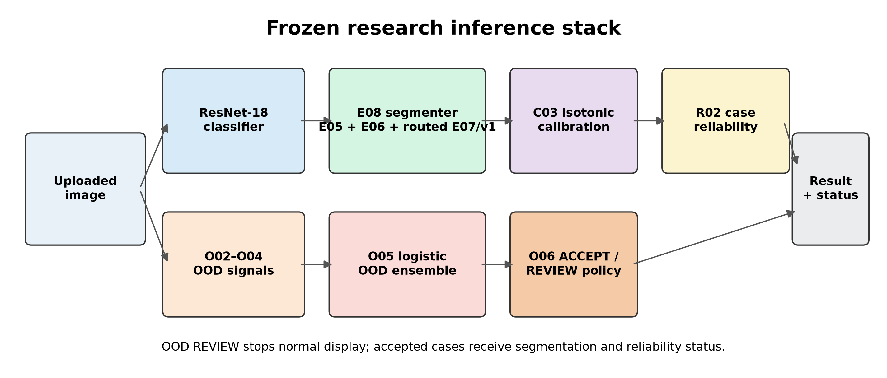

**Figure 1.** Frozen research inference stack. OOD review precedes normal display. Accepted inputs receive classification, segmentation, calibrated pixel probabilities, and a case-reliability state. Source: [final stack manifest](../runs/final_stack/manifest.json).

### 1.5 Contributions

The work contributes five things at an undergraduate research-engineering scale.

First, it delivers a complete artifact chain from raw dataset audit to a hash-verified inference package. Second, it decomposes spatial failure rather than describing glioma only as “hard.” Third, it tests multiple calibration and reliability approaches with out-of-fold evaluation and registered stopping rules. Fourth, it evaluates transport on independent external cohorts without adapting the frozen stack and reports the failure. Fifth, it builds OOD and reliability policies that are explicit about cost assumptions, threshold fragility, and fail-closed behavior.

The contribution is methodological and educational. It demonstrates how to build and audit a serious research prototype. It does not establish medical effectiveness.

## 2. Related work

### 2.1 Brain-tumor segmentation

Modern brain-tumor segmentation research commonly uses encoder–decoder networks, U-Net variants, automated configuration systems such as nnU-Net, and multi-modal three-dimensional MRI. Public challenges such as BraTS drove progress through patient-level volumes, multiple MRI sequences, and region-specific targets. Those settings differ materially from BRISC’s heterogeneous two-dimensional images. A compact two-dimensional model can be appropriate for a laptop-scale research project, but it lacks the through-plane context and modality structure available to three-dimensional clinical-research pipelines.

The project’s literature review found a repeated pattern: reported Dice depends heavily on dataset definition, modality, target region, preprocessing, and evaluation unit. A number from a BraTS whole-tumor task cannot be compared directly with a BRISC slice-mask result. The [BRISC paper](https://arxiv.org/pdf/2506.14318) documents two-dimensional T1-CE images, resized data, absent complete patient identifiers, and lower glioma IoU than the other two tumor categories across its listed baselines. The [original BraTS benchmark](https://pmc.ncbi.nlm.nih.gov/articles/PMC4833122/) illustrates multi-rater ambiguity and lower overlap for small active regions even in multimodal three-dimensional data. The review also found that diffuse glioma margins, heterogeneous appearance, small lesions, class imbalance, and annotation uncertainty create different failure mechanisms. [Glioma literature review](glioma_literature_review.md)

### 2.2 Boundary-aware and imbalance-aware learning

Dice-style losses address foreground imbalance by directly optimizing overlap, while weighted binary cross-entropy changes the penalty assigned to foreground and background pixels. [Generalized Dice](https://arxiv.org/abs/1707.03237) reweights class volume under severe imbalance, and [Kervadec et al.](https://proceedings.mlr.press/v102/kervadec19a.html) combine a distance-transform boundary objective with a region loss. [nnU-Net’s BraTS work](https://arxiv.org/abs/2011.00848) shows that strong results often come from a dataset-adapted pipeline rather than one architectural novelty. The project tested weighted training, boundary-aware training, specialist routing, ensembles, test-time augmentation, multi-scale inference, morphology, and connected-component filtering. No single intervention cleared the registered parent H1 improvement of at least 0.05 glioma Dice without unacceptable category degradation. The E08 ensemble did pass its local gate and later satisfied the H7 selection amendment when calibration and reliability conditions also passed.

This distinction matters. E08 is the selected final segmenter because it met the registered final-selection rule, not because every underlying model passed the original replacement hypothesis. [E08 result](../experiments/e08_ensemble/result.json) [Final selection](../experiments/e08_final_selection/result.json)

### 2.3 Calibration

Calibration concerns agreement between predicted probabilities and observed frequencies. A model may rank cases well but assign probabilities that are too high or too low. Classification calibration and segmentation calibration are different because segmentation produces millions of highly imbalanced, spatially dependent pixel scores. Whole-image calibration can appear excellent when easy background pixels dominate, so this project also evaluates a fixed lesion-centered region.

Temperature scaling, vector or parametric mappings, isotonic regression, category-specific mappings, and hierarchical variants were examined. C03 isotonic regression was selected because it passed its registered operational gate while preserving the fixed hard mask. Several alternatives improved numerical calibration but were rejected because they changed hard masks, depended on reference information at inference, or failed a subgroup condition. [Unified calibration comparison](../experiments/c08_unified_ece/result.json)

### 2.4 Uncertainty and reliability estimation

Pixel entropy does not by itself answer whether a whole predicted mask is usable. A model can be confidently wrong in the wrong location. The project therefore defines a case-level reliability target: whether Dice is at least 0.50 on internal validation. The R02 model uses ten features computed from the prediction, its calibrated probability map, and its geometry. Its output is a retrospective estimate tied to the registered internal target, not a probability of clinical correctness.

This approach resembles selective prediction: the application accepts a subset of cases and refers the rest for review. The project explicitly optimizes a cost model rather than selecting 0.50 by convention. The resulting threshold is high because the chosen missed-failure cost is ten times the review cost. That policy is fragile to threshold perturbation, so the exact full-precision value is frozen.

### 2.5 Out-of-distribution detection

OOD methods attempt to identify inputs that differ from the model’s training distribution. Common signals include input statistics, softmax confidence, entropy, embeddings, and Mahalanobis distance. No detector covers all possible shifts. The selected O05 model combines four registered signals: image-statistics probability, bottleneck Mahalanobis distance, classifier uncertainty, and segmenter entropy. It performs very well on the registered benchmark, but its strongest component can exploit source and file-encoding cues. The result is useful as a protective research gate and insufficient as evidence of universal safety.

## 3. Data

### 3.1 BRISC development data

The audited BRISC package contains 6,000 readable classification images: 5,000 in the supplied training layout and 1,000 in the supplied test layout. Counts were 1,147/254 glioma, 1,329/306 meningioma, 1,457/300 pituitary, and 1,067/140 no-tumor across the supplied train/test folders. The mask audit found 4,793 matched masks for tumor-positive images and no basic readability defects. The project-created development split assigned 3,570 images to training, 893 to validation, 1,000 to the sealed test set, and 537 to review exclusion. [Pre-registration data inventory](../audit/preregistration.md)

For segmentation, the frozen development split contained 2,719 training pairs and 680 validation pairs: 204 glioma, 227 meningioma, and 249 pituitary validation cases. The 860 supplied positive test pairs remained sealed. Similarity-aware grouping reduced obvious leakage across development folds, but patient independence remained unverified because stable patient identifiers were not available across the assembled sources. [Segmentation configuration](../runs/segmentation/20260923-072439-397263-full/config.json)

Physical image paths such as `classification_task/train/...` describe BRISC storage layout rather than analytical split membership. The project’s manifest and `draft_split` field determine whether a stored file belongs to training, validation, test, or review exclusion. The reproducibility audit recomputed all 680 validation predictions with zero aggregate and per-image metric difference. [Segmentation reproducibility audit](../audit/segmentation_reproducibility.md)

### 3.2 Label and target definitions

The classifier label space is exactly four classes: glioma, meningioma, pituitary, and no tumor. These are dataset categories, not comprehensive neuropathology diagnoses. The segmentation target is a binary mask supplied for tumor-positive images. The system does not infer histologic grade, etiology, depth below skull, treatment response, organ failure, or prognosis.

The hard segmentation threshold is fixed at 0.50. C03 maps raw probabilities for presentation and downstream reliability features, but the selected calibration operation does not alter the registered hard mask. Case reliability defines a “successful” segmentation as Dice at least 0.50 for its registered internal target. OOD status is separate and can stop normal display before reliability is used.

### 3.3 External evidence roles

Four external datasets were registered, but they do not play equivalent roles.

**Cheng/Figshare v8 (X01)** is an overlap-control cohort because BRISC incorporates material derived from Cheng. It is useful for checking source overlap and pipeline behavior, but it cannot establish independent generalization. Its overall subject-macro Dice was 0.6688, with glioma 0.4142, meningioma 0.8679, and pituitary 0.7712.

**OpenNeuro ds006248 (X02)** is an independent pituitary cohort. Fifty subjects contributed 425 registered tumor-bearing slices. Classification recall transported reasonably, but strict subject-macro segmentation Dice was only 0.1272. Five source targets disappeared when the frozen mask adapter reduced them to 128×128; they were assigned Dice zero in the primary conservative analysis and listed explicitly.

**UPENN-GBM (X03)** is an independent glioblastoma cohort. Glioblastoma is a subtype of glioma, but mapping this GBM-only whole-tumor cohort to heterogeneous BRISC glioma is coarse. Across 147 subjects and 9,464 tumor-bearing slices, strict subject-macro Dice was 0.2208. Eighty-two targets containing only 1–15 native pixels disappeared at 128×128 and were assigned Dice zero in the primary analysis.

**Meningioma-SEG-CLASS (X04)** required controlled access. Access was not granted within the registered execution window, so X04 is `ACCESS_BLOCKED` and contributes no performance estimate. The project therefore has no independent meningioma transport result. [Cross-dataset synthesis](../audit/stage6_cross_dataset.md)

### 3.4 OOD benchmark sources

The OOD benchmark used 600 BRISC development-training images for ID fitting and 680 BRISC validation images for ID evaluation. Near-OOD sources were Cheng, OpenNeuro, and UPENN-GBM. Far-OOD sources were OrganAMNIST, CIFAR-10, seeded random noise, and seeded uniform gray. Each OOD source contributed 100 fitting and 100 evaluation images. The final held-out benchmark therefore contained 680 ID and 700 OOD evaluation images.

The near-OOD images had already been examined during Stage 6, although Stage 6 masks and performance values did not enter OOD fitting. This historical exposure and the presence of easy far-OOD sources limit the OOD claim. The benchmark measures separation for these registered sources, not every possible scanner, artifact, orientation, image type, or adversarial input. [Stage 7 report](../audit/stage7_completion_report.md)

### 3.5 Data governance

Every registered experiment used committed configs, source hashes, or manifest hashes. Bootstrap resampling respected similarity groups internally and patient identifiers externally where available. Dataset audits preceded external evaluation. When a target became unrepresentable, a loader changed datatype unexpectedly, or bootstrap membership was inconsistent, evaluation stopped and required a preregistered amendment before restarting. These stops are part of the evidence, because they show the fail-closed process working.

No image from the sealed BRISC test partition was used for training, model selection, calibration, reliability fitting, OOD fitting, policy selection, or this report. All BRISC performance values are internal development-validation values.

## 4. Methods

### 4.1 Shared preprocessing principles

Preprocessing was frozen separately for the classifier and segmenter. Both pipelines convert an input into a standardized model-space canvas while preserving aspect ratio and centering the resized image on black padding. The classifier uses a 224×224 canvas, repeats grayscale into three channels, and applies ImageNet normalization. The segmenter uses a single-channel 128×128 canvas and scales intensity to the registered range. Masks use nearest-neighbor spatial conversion so label values remain binary. Image resampling uses bilinear interpolation.

This design made the laptop-scale workflow practical, but it creates a measurable small-target limit. Five OpenNeuro masks and 82 UPENN masks became empty after the frozen target transform. The adapter was not changed after this finding; the strict external analyses counted these cases as zero Dice. Native-resolution restoration was evaluated separately and showed that these erased targets were not the main explanation for broad external failure.

### 4.2 Classifier

The classifier is a torchvision ResNet-18 initialized with ImageNet-1K v1 weights and modified for four output classes. The training configuration used a batch size of 8, Adam-style optimization through the registered training script, learning rate 0.0001, weight decay 0.0001, and early stopping on validation macro F1 with patience 5. Training-only augmentation applied brightness and contrast jitter of 0.1; no geometric augmentation was used. The frozen classifier exposes raw softmax probabilities because both multiclass and binary temperature-scaling experiments failed to show a statistically stable improvement over already strong raw calibration. [Classifier config](../runs/classifier/20260921-170607-243133-baseline/config.json) [Calibration findings](../audit/confidence_calibration_findings.json)

The classifier supports two downstream decisions. Its top label selects the displayed category and routes the third component of E08: predicted glioma uses the E07 specialist; other predictions use v1. Classifier uncertainty also contributes one OOD signal. The classifier does not determine whether the mask is spatially correct; Stage 4 showed that 78 of 83 weak v1 segmentations still had correct classification, including 16 of 17 zero-Dice cases. [Agreement analysis](../audit/classifier_segmenter_agreement.json)

### 4.3 Segmenter v1

The historical v1 segmenter is a compact two-dimensional MONAI U-Net with channels 16, 32, 64, and 128, two residual units, a linear logit head, and 401,277 trainable parameters. It was trained at 128×128 with per-image foreground/background balanced binary cross-entropy plus foreground Dice loss. AdamW used learning rate 0.001, weight decay 0.0001, batch size 8, mixed-precision model forward, and FP32 loss and parameters. The registered run allowed 75 epochs and early stopping patience 12. The selected metric was the macro mean of image-level hard Dice across glioma, meningioma, and pituitary.

The initial tiny-set gates were intentionally diagnostic. A six-pair overfit test established that the architecture and loss could memorize a small set at the fixed threshold. It did not establish validation performance. Full training then produced the v1 benchmark used for failure analysis and controlled intervention comparisons. [V1 config](../runs/segmentation/20260923-072439-397263-full/config.json)

### 4.4 E08 ensemble

E08 averages three probability maps with equal weight:

1. E05, trained with glioma-weighted loss;
2. E06, trained with a boundary-aware loss; and
3. a routed component that uses E07 for classifier-predicted glioma and v1 otherwise.

The arithmetic mean is thresholded at the unchanged 0.50 segmentation threshold. E05, E06, and E07 were rejected as standalone final replacements under their own registered gates. They remain in the frozen package only because they are required components of the selected ensemble. E08 passed its local gate by improving glioma over the best eligible single model and avoiding unacceptable meningioma or pituitary losses. Amendment 02 then allowed E08 to become final if later calibration and reliability conditions passed. H7 was satisfied.

This routing introduces dependence on the classifier. A misclassified category can select the wrong route. E08 also requires four segmenter checkpoints plus routing logic; model selection did not evaluate latency, energy use, or deployment burden, so its measured Dice gains should be read alongside that unquantified operational cost. The final package preserves this behavior exactly and includes the classifier, all four segmenter checkpoints, configs, and expected outputs. [E08 result](../experiments/e08_ensemble/result.json) [Final stack manifest](../runs/final_stack/manifest.json)

### 4.5 C03 isotonic calibration

Raw E08 pixel probabilities were calibrated with five-fold cross-fitted isotonic regression. In each fold, a monotonic mapping was fitted on four similarity-aware folds and applied to the held-out fold. The reported calibration metrics use only out-of-fold mapped probabilities. A separate final mapping was fitted on all 680 validation cases solely as the proposed operational mapping and is stored in the frozen stack; it was not used to report C03 performance.

Calibration was evaluated in three regions. Whole-image metrics include every pixel and are dominated by background. Background metrics evaluate outside the fixed lesion-centered region. Lesion-centered metrics evaluate a fixed model-space region around the reference lesion for analysis only. The reference region is never required when applying the final mapping to a new prediction; isotonic calibration itself is a global mapping from probability to probability.

C03 reduced lesion-centered ECE from 0.05054 to 0.03351 and NLL from 0.31716 to 0.22448. The hard mask remained bitwise identical at 0.50, which was a required operational condition. [C03 result](../experiments/c03_isotonic/result.json)

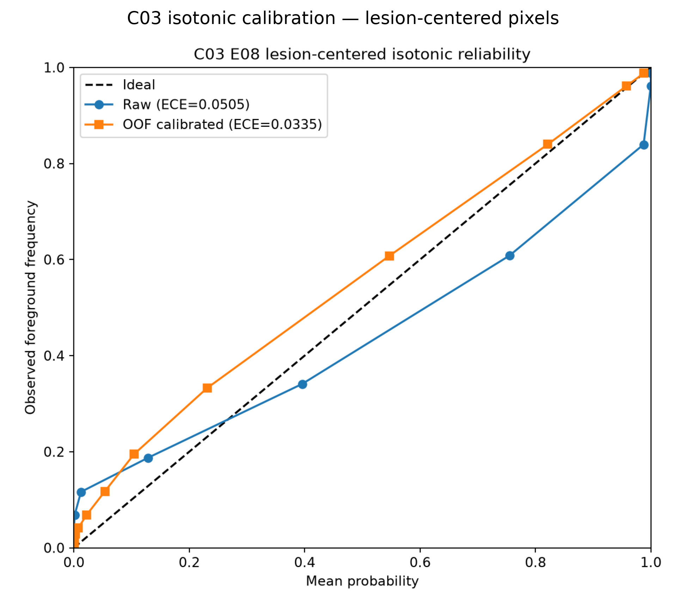

**Figure 4.** Lesion-centered pixel reliability before and after C03 isotonic calibration. Reported calibrated values are out of fold. Source: [C03 artifacts](../experiments/c03_isotonic/artifacts/lesion_centered_reliability.png).

### 4.6 R02 case-level reliability

R02 is an L2-regularized logistic regression preceded by a StandardScaler. Its target is the probability that a segmentation achieves Dice at least 0.50 on the registered internal task. It uses ten features in a fixed order:

1. empty-prediction indicator;
2. predicted foreground area fraction;
3. whole-image probability mean;
4. whole-image probability standard deviation;
5. mean entropy inside the predicted region;
6. mean boundary entropy;
7. high-confidence foreground fraction;
8. uncertain-pixel fraction;
9. bounding-box fill ratio; and
10. normalized perimeter.

All features are computed at inference from the image-independent calibrated prediction, its hard mask, or its geometry. No reference mask, true tumor type, Dice score, or classifier probability enters the feature vector. Boundary entropy was the dominant failure predictor across ablation, permutation, linear, and nonlinear comparisons. Its negative logistic coefficient means higher boundary entropy reduces estimated reliability, holding the other standardized features fixed. Coefficients are descriptive associations, not causal effects.

R02 was evaluated through five similarity-aware folds. The frozen deployment scaler and logistic model were later fitted once on all 680 validation cases under Amendment 14. That full-population fit is used only for new-case inference. The reported AUROC, ECE, and Brier skill remain out-of-fold values. [R02 result](../experiments/r02_reduced_features/result.json) [Deployable model manifest](../models/r02_reliability_manifest.json)

### 4.7 Reliability policy

The registered cost model assigns unit cost to a case sent for review, zero cost to a correct standard acceptance, and cost 10 to a weak segmentation accepted without review. For each candidate reliability threshold, expected cost is

\[
C(\theta)=1\,TP_{review}(\theta)+1\,FP_{review}(\theta)+10\,FN_{failure}(\theta),
\]

where “positive” denotes review-required under the failure-detection framing. The exhaustive sweep over distinct out-of-fold scores selected `0.9490250173235835`. Scores below the threshold are `REVIEW_REQUIRED`; scores at or above it are `STANDARD`. Invalid or unavailable scores fail closed to review. An exhaustive three-state search found no warning band that reduced cost under the registered assumptions, so the policy has two states.

The threshold is an internally optimized operating rule, not a universal truth. It is fragile: moving it by 0.05 can raise worst-case cost from 205 to 628. The exact value is therefore stored and applied at full precision. A different review cost, failure cost, clinical setting, cohort, or prevalence would require a new preregistered policy study rather than informal adjustment. [Cost model](cost_model.md) [Policy](decision_rule.md)

### 4.8 O05 OOD detector

O05 combines four component scores:

- O02 probability from image statistics;
- O03 Mahalanobis distance in a frozen segmenter bottleneck embedding;
- O04 classifier uncertainty, defined through maximum softmax confidence; and
- O04 segmenter whole-image mean Bernoulli entropy.

Each component is transformed by its empirical cumulative distribution on 600 BRISC fitting images. A fixed secondary L2 logistic regression combines the four normalized scores. Its standardized coefficients are 6.520 for O02, 1.383 for O03, 0.678 for classifier uncertainty, and 0.844 for segmenter entropy. O02 therefore dominates. This dominance helps explain the high benchmark AUROC and the risk that the detector learns acquisition or file-format shortcuts.

O03 uses a Ledoit–Wolf covariance estimator. The original fitted precision matrix had not been serialized as a deployable artifact. During Stage 8 it was deterministically reconstructed from the frozen 600 fitting embeddings and reproduced every registered squared Mahalanobis distance with maximum absolute error 0.0, passing the 1e-12 gate. This was deterministic artifact recovery, not model fitting or selection.

### 4.9 O06 OOD policy and execution order

The OOD review threshold is the 95th percentile of the 600 BRISC fitting scores: `0.36854275476100085`. Scores below it are `ACCEPT`; scores at or above it are `REVIEW`. Missing, invalid, non-finite, or out-of-range scores fail closed to review. A possible REFUSE threshold failed its registered enablement rule because it falsely refused more than one percent of BRISC validation images, so REFUSE is disabled.

Execution order is deliberate. The input is validated, OOD component scores are computed, and O06 is applied. Only `ACCEPT` continues to normal classifier/segmenter display. Accepted cases then receive the existing reliability policy. OOD review and mask-reliability review have different meanings: one concerns input distribution; the other concerns expected spatial overlap on a BRISC-derived internal task.

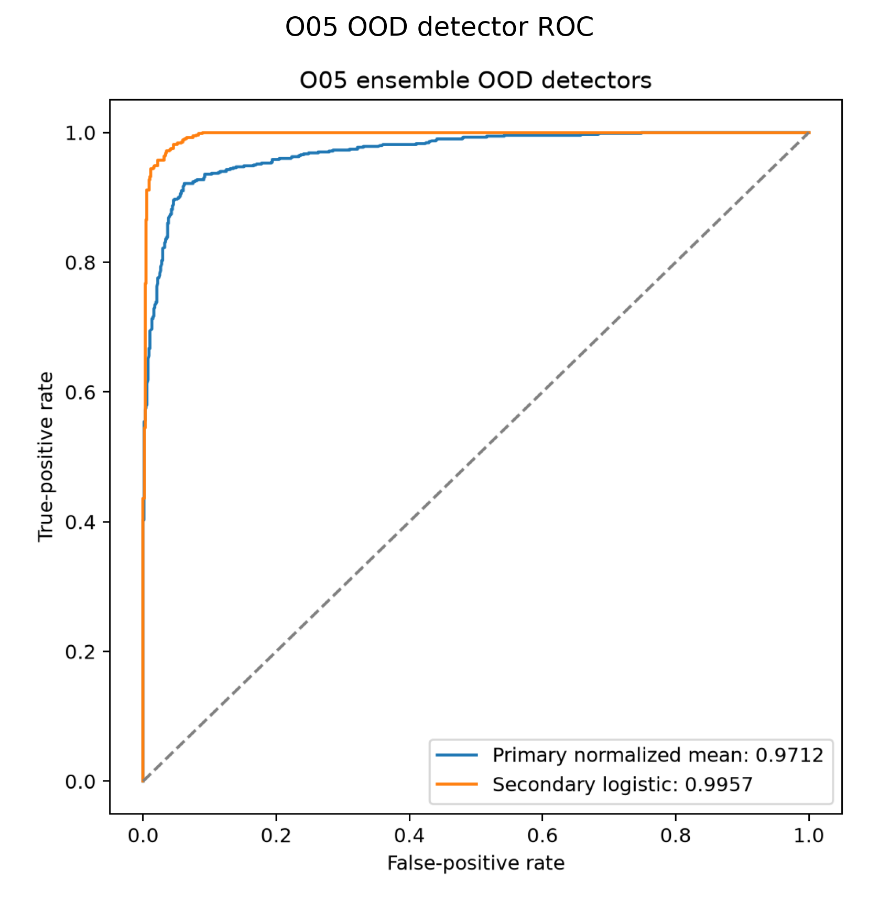

**Figure 6.** O05 held-out ROC on the registered retrospective ID/OOD benchmark. Source: [O05 result](../experiments/o05_ensemble_ood/result.json).

### 4.10 Evaluation metrics and uncertainty

Dice and intersection-over-union measure spatial overlap. Macro F1 averages class-level F1 scores. AUROC measures ranking across thresholds. NLL and Brier score evaluate probabilistic predictions; lower is better. ECE summarizes weighted absolute differences between mean predicted probability and observed frequency within bins. Brier skill compares a model’s Brier score with a constant prevalence baseline. Full formulas, conventions, and derivations are provided in [methods.md](methods.md).

Where registered, 95% confidence intervals use 2,000 bootstrap resamples. Internal case analyses resample similarity groups. External analyses resample patients. Paired comparisons resample the same groups for both models before taking the difference. These intervals quantify resampling uncertainty for the observed datasets; they do not repair unverified patient independence, dataset shift, label uncertainty, or selection on a single development source.

## 5. Experiments and governance

### 5.1 Stage 0 — foundation reset

Stage 0 established the formal preregistration, immutable v1 baseline, experiment-directory contract, and review log. Each registered experiment contains a hypothesis, fixed config, result, decision, and artifact manifest. The preregistration states metrics, gates, datasets, resampling procedures, and the rule that gates will not be relaxed after results are seen. [Pre-registration](../audit/preregistration.md)

### 5.2 Stage 1 — glioma failure decomposition

Stage 1 converted the broad observation “glioma is weak” into measured failure characteristics. It computed geometry, overlap, centroids, components, bounding boxes, edge contact, orientation, and boundary sharpness. Human review added edema, enhancement, ventricle proximity, and focality descriptions without converting them into model inputs. Matched success/failure case studies controlled approximately for mask area.

The strongest result was size sensitivity. Among glioma masks smaller than 100 model-space pixels, 21 of 32 failed the Dice 0.50 criterion. Small-mask failure risk exceeded the larger-mask groups by 0.430 with bootstrap 95% CI 0.258–0.592. Boundary class, focality, and central versus peripheral location did not independently clear the registered predictor rule. This does not mean those factors never matter; it means the observed evidence supported target size more strongly in this model and dataset. [Glioma findings](../audit/glioma_failure_findings.md)

### 5.3 Stage 2 — controlled segmentation improvements

Stage 2 executed connected-component filtering, morphology, test-time augmentation, multi-scale inference, glioma-weighted retraining, boundary-aware retraining, a glioma specialist, and an ensemble. Each experiment preserved the split, threshold, and evaluation rules unless its registered intervention explicitly changed training loss or inference aggregation.

No intervention achieved the H1 parent gate of at least +0.05 glioma Dice over v1 while keeping meningioma and pituitary within tolerance. E08 passed its local ensemble gate and improved every category over v1, but its glioma gain over v1 was +0.0234. The project recorded H1 as failed rather than redefining success. Amendment 02 registered a separate future-facing H7 condition before Stages 3–4: E08 could ship if calibration passed and reliability AUROC met or exceeded v1’s 0.941 comparator. [Model selection](../audit/v2_model_selection.md)

### 5.4 Stage 3 — calibration

Stage 3 ran separate, registered experiments C01–C09. C01 vector scaling passed its numerical gate. C02 Dirichlet calibration failed operationally because it changed 43,228 hard-mask pixels and failed the zero-changed-pixels/images requirement. C03 isotonic regression passed and was selected. C04 produced strong values but used an oracle foreground/background region distinction that is unavailable during inference, so it was operationally ineligible. C05 reliability weighting failed its gate. C06 failed the glioma lesion ECE condition. C07 passed numerically but inherited inference-ineligible reference-dependent routing. C08 unified ECE binning, and C09 generated per-category diagrams.

The selected result reflects both metrics and deployability. A lower ECE alone did not make a method eligible if the method needed the reference mask or changed the fixed hard mask. [Calibration completion](../audit/stage3_calibration_report.md)

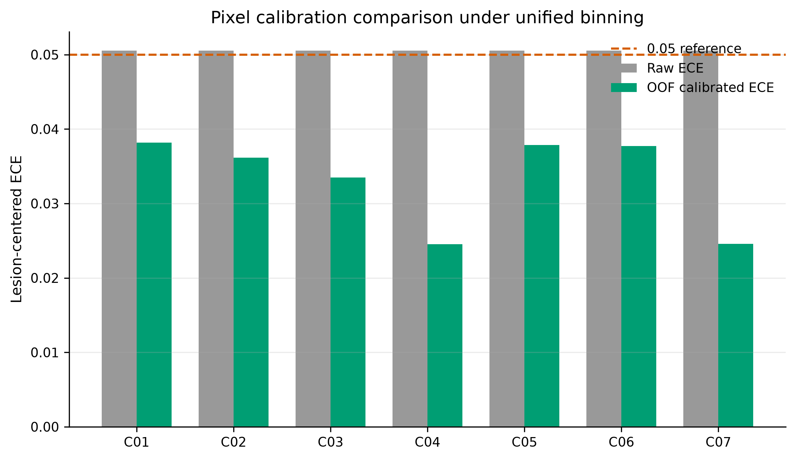

**Figure 9.** Lesion-centered ECE for C01–C07 under C08’s unified 15-bin equal-frequency recomputation. Several numerically strong alternatives were operationally ineligible. Source: [C08 table](../experiments/c08_unified_ece/artifacts/segmenter_ece_table.csv).

### 5.5 Stage 4 — reliability model selection

R01 established a 14-feature logistic baseline and ablated each feature. R02 removed four registered low-value features and slightly improved AUROC, becoming the operational model. R03 added six geometric and image-boundary features but reduced overall performance and sharply degraded pituitary ranking. R04 separate category models passed a permissive gate but degraded every category relative to the aggregate model because some categories had too few failures. R05 category indicators produced no meaningful glioma improvement. R06 XGBoost, a small MLP, and random forest all performed worse than R02. R07 documented coefficient confidence intervals. R08 tested prospective fold evaluation, R09 fold sensitivity, and R10 seed stability.

The selection rule therefore retained R02: it had stronger discrimination than the original baseline, good calibration, useful catastrophic-failure capture, stable interpretable coefficients, and lower complexity than the nonlinear alternatives. Glioma remained the weakest subgroup. [Stage 4 report](../audit/stage4_completion_report.md)

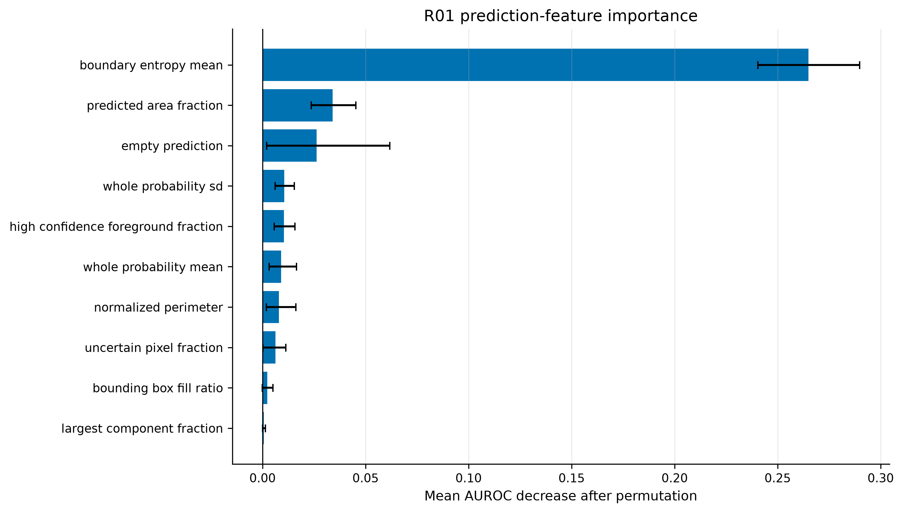

**Figure 10.** R01 held-out permutation importance. Boundary entropy dominates the prediction-only reliability feature set. Error bars are registered bootstrap confidence intervals. Source: [R01 importance](../experiments/r01_ablation/artifacts/permutation_importance.csv).

### 5.6 Stage 5 — reliability policy

Stage 5 converted R02 scores into an explicit policy. P01 registered costs. P02 exhaustively selected the cost-minimizing threshold. P03 formalized the two-state policy and boundary tests. P04 created a fixed message catalogue with general and predicted-glioma variants, fail-closed messages, and the required research disclaimer. P05 quantified threshold sensitivity.

The two-state result was evidence-driven. Under the registered cost model, no warning interval improved expected cost relative to a single threshold. The application must therefore display either `STANDARD` or `REVIEW_REQUIRED` for reliability, with no intermediate warning state. [Stage 5 report](../audit/stage5_completion_report.md)

### 5.7 Stage 6 — external transport

Stage 6 audited four planned external datasets and evaluated three. X01 was an overlap control. X02 and X03 were independent retrospective cohorts. X04 remained access blocked. The frozen E08+C03+R02 stack was applied without retraining, refitting, or threshold adjustment. Classification, segmentation, calibration, failure taxonomy, domain gap, and reliability ranking were reported with patient-cluster confidence intervals where estimable.

Both independent cohorts failed the registered H8 transport gates. OpenNeuro showed high pituitary label recall but very low segmentation Dice. UPENN-GBM showed poor category recall and poor spatial overlap. OpenNeuro reliability AUROC was 0.8719 with ECE 0.2551, and UPENN reliability AUROC was 0.8316 with ECE 0.3391: ranking survived better than spatial overlap, but probabilities were miscalibrated. H8 was rejected for the evaluated independent cohorts. [Stage 6 synthesis](../audit/stage6_cross_dataset.md)

### 5.8 Stage 7 — OOD detection

Stage 7 assembled a registered benchmark, evaluated three classes of OOD signal, combined them, and fixed an application policy. O02 image statistics and O03 embeddings passed their individual gates. Classifier uncertainty and segmenter entropy failed their individual 0.85 AUROC gates. The O05 secondary logistic combination exceeded both the registered 0.92 gate and the equal-weight primary ensemble by more than the preregistered margin with paired CI above zero. H9 passed.

The OOD result mitigates one registered source-shift pathway but does not solve external failure or establish safety. It can stop normal display for sources resembling the registered external cohorts. It cannot guarantee recognition of a new hospital, subtle acquisition shift, plausible but corrupted MRI, or adversarial input. [Stage 7 report](../audit/stage7_completion_report.md)

### 5.9 Stage 8 — final freezing

Stage 8 copied only allowlisted artifacts into `runs/final_stack/`, recorded SHA256 and byte size for each, and built a strict loader that rejects missing or unexpected files. The freeze contains five neural checkpoints, C03 mapping, R02 scaler and logistic estimator, O02/O03/O05 states, O06 policy, runtime code, environment locks, synthetic fixtures, and expected outputs.

Three fixtures reconstructed classification, E08 routing, pixel maps, calibration, hard masks, R02 reliability, all OOD components, O05, and O06 twice within 1e-12. Hard-mask and probability hashes matched exactly. The freeze completed with 207 tests passing and Ruff clean. [Stage 8 report](../audit/stage8_final_freezing.md)

### 5.10 Amendments and review trail

Twenty-one preregistration amendments were added before the affected result was inspected or the restarted analysis continued. They cover such issues as calibration operational constraints, reliability evaluation, external transport, serialization of R02, unrepresentable targets, datatype preservation, bootstrap membership, OOD detection, and the response to external adversarial review. Amendments did not erase failed attempts. The X03 decision file, for example, records unrepresentable targets, a native-datatype loader defect, a bootstrap-membership defect, and the authorized final restart.

At the external-review cutoff, the repository contained 49 experiment packages: 33 numbered E/C/R/O packages and 16 policy, validation, or governance packages. Amendment 21 added four separately registered packages, bringing the current registry to 53. R02 feature reduction, O05 secondary-ensemble selection, P02 threshold selection, the post-H1 H7 pathway, and the glioma subgroup predictor search are exploratory or development model-selection analyses even where they were prospectively registered before their own outcomes were inspected. This multiplicity is relevant to how strongly their results should be generalized.

The review log links decisions to artifact hashes and records whether the user or a predeclared rule approved them. This governance cannot remove every bias, but it makes analytical choices visible and limits quiet post-hoc changes. [Review log](../audit/review_log.md) [Amendment index](appendix.md#amendments)

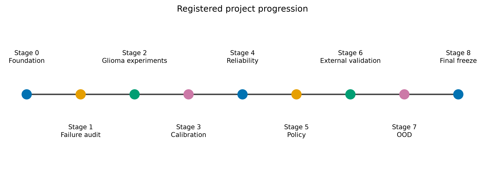

**Figure 12.** Registered progression from foundation through the frozen stack. Source: [experiment registry](../experiments/registry.json) and [review log](../audit/review_log.md).

## 6. Results

### 6.1 Classifier

The v1 classifier achieved internal-validation macro F1 0.9779 and accuracy 0.9776. Recall was 0.9804 for glioma, 0.9427 for meningioma, 0.9920 for pituitary, and 0.9953 for no tumor. Meningioma was the weakest classification category, although its recall remained high within this internal split. These values are development-validation metrics, and unverified patient independence prevents interpreting them as performance on unseen patients. [Classifier findings](../audit/classifier_training_findings.json)

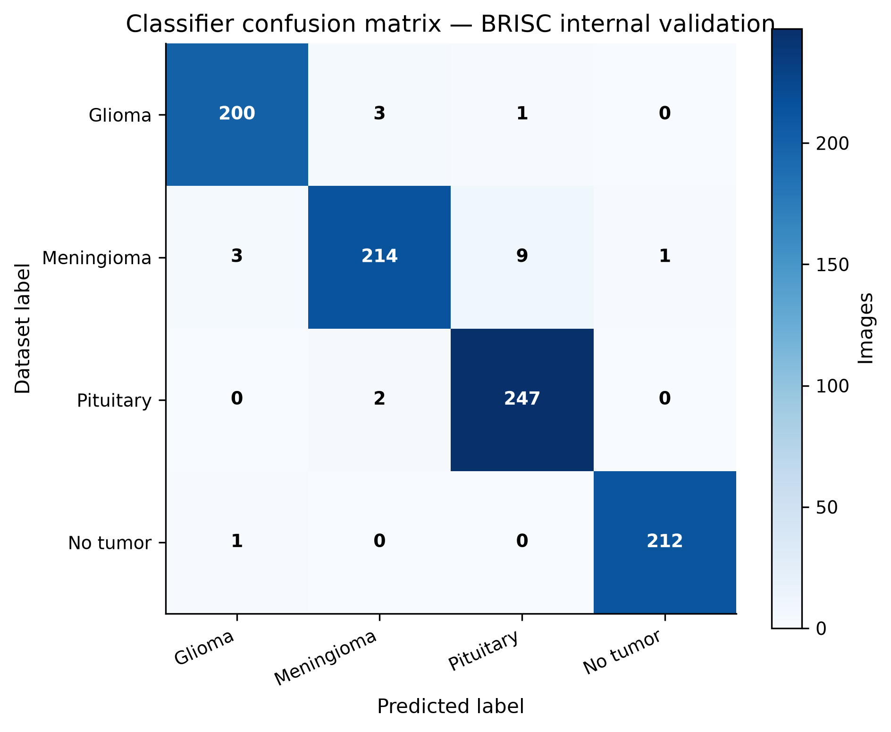

**Figure 2.** Four-class confusion matrix on the BRISC internal development-validation predictions. Source: [classifier predictions](../runs/classifier/20260921-170607-243133-baseline/validation_predictions.csv).

Raw classifier probabilities were retained. Multiclass and binary temperature scaling did not produce statistically stable improvement over already low raw calibration error. The correct conclusion was that additional classifier calibration was unnecessary, rather than that a calibration experiment had to “win.”

### 6.2 Segmenter v1 and E08

The historical v1 segmenter achieved image-mean Dice 0.7694 and macro category Dice 0.7627. Category means were 0.6090 for glioma, 0.8702 for meningioma, and 0.8088 for pituitary. These exact values remain important because most detailed Phase 4 failure audits began with v1. [Segmentation findings](../audit/segmentation_training_findings.json)

E08 improved every category mean to 0.6324 glioma, 0.8822 meningioma, and 0.8183 pituitary. Its changes from v1 were +0.0234, +0.0119, and +0.0096 respectively. The glioma improvement over the best eligible single v2 model was +0.0522 with paired group-bootstrap CI 0.0322–0.0744. E08 weak cases below Dice 0.50 numbered 56 glioma, 2 meningioma, and 11 pituitary. [E08 result](../experiments/e08_ensemble/result.json)

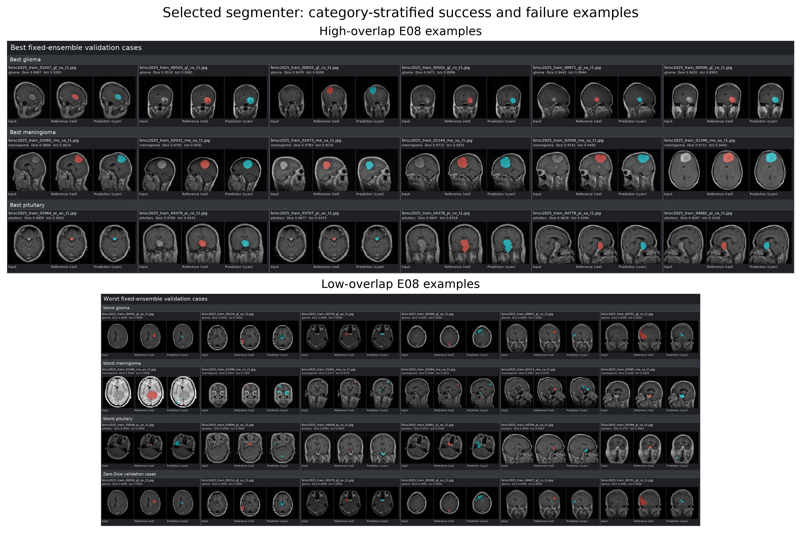

**Figure 3.** Deterministic E08 best and worst validation examples by category. Red is reference and cyan is prediction in the source panels. The visual audit found no systematic flip, stretch, offset, or pairing defect. Source: [E08 artifacts](../experiments/e08_ensemble/artifacts/visual_audit_selections.csv).

The improvement does not remove the glioma weakness. Glioma’s mean remains far below meningioma and pituitary, and most E08 weak cases are glioma. E08 was selected because it passed the amended final rule, not because it reached a clinical or cross-dataset target.

### 6.3 Failure modes

The v1 audit found 83 cases below Dice 0.50. Overlapping flags identified fragmentation in 70/83 (84.3%) and disconnected false positives in 67/83 (80.7%). Complete misses occurred in 17 cases, severe under-prediction in 19, and severe over-prediction in 24. Because flags overlap, percentages do not sum to 100. [Failure modes](../audit/segmentation_failure_modes.md)

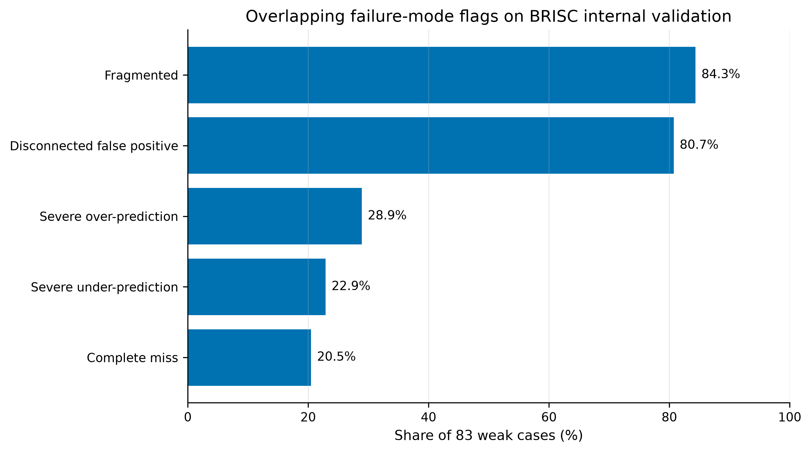

**Figure 8.** Overlapping failure-mode flags among 83 weak v1 validation cases. Source: [failure-mode report](../audit/segmentation_failure_modes.md).

Classifier and segmenter outcomes were partly decoupled. Seventy-eight of the 83 weak segmentations still had correct classification; 16 of 17 zero-Dice cases had the correct class. Classifier confidence correlated only modestly with segmenter Dice (Spearman 0.3252) and weakly with inside-mask segmenter probability (0.1660). These results show why a classifier probability cannot stand in for spatial reliability. [Agreement](../audit/classifier_segmenter_agreement.md) [Uncertainty signals](../audit/segmentation_uncertainty_signals.md)

### 6.4 Glioma decomposition

Target size was the clearest glioma risk factor. Small masks below 100 pixels failed in 21/32 cases (65.6%) with mean Dice about 0.393. Medium masks from 100–500 pixels failed in 27/135 cases (20.0%), while large masks above 500 pixels failed in 12/37 cases (32.4%). The registered small-versus-larger failure-risk difference was +0.430 with CI +0.258 to +0.592.

Diffuse versus sharp boundary, single versus multifocal appearance, and central versus peripheral location did not independently meet the registered predictor rule after the stratified analysis. Visual differences still existed, but they were not as predictive as area in this sample. This result redirected interpretation away from a vague claim that “glioma boundaries are hard” toward a more precise claim: the frozen low-resolution system is particularly sensitive to small glioma targets. [Subgroup analysis](../audit/glioma_subgroup_analysis.md)

Small target area is the strongest observed association in this model and dataset. Because Dice is mathematically coupled to object size, this is partly a metric artifact and is not a causal claim. R11 added complementary size-robust views: E08 improved 2-pixel surface Dice over v1 by +0.0143, but its group-bootstrap CI of −0.0108 to +0.0391 crossed zero; HD95 improved by 2.396 pixels with CI 1.107–3.826; and lesion-detection sensitivity changed by only +0.0047 with a CI crossing zero. H10 passed its registered point-direction gate, while the uncertainty shows that the evidence is strongest for boundary distance and ordinary overlap rather than a uniform improvement across every size-robust metric. [R11 result](../experiments/r11_size_robust_metrics/result.json)

### 6.5 Pixel calibration

C03 reduced lesion-centered pixel ECE from 0.05054 to 0.03351, NLL from 0.31716 to 0.22448, and Brier score from 0.07038 to 0.06337. The hard mask remained identical at the 0.50 threshold. Whole-image calibration became extremely small because background dominates, reinforcing the need for lesion-centered reporting.

Calibration did not solve spatial localization. A monotonic mapping can improve probability honesty while leaving rank order and the hard mask fixed. Therefore a confidently misplaced region remains misplaced after C03. This is why calibration, reliability, and segmentation quality are reported separately.

### 6.6 Case-level reliability

R02 achieved failure-detection AUROC 0.9555 with 95% CI 0.9387–0.9704, ECE 0.0171, and Brier skill 0.5033. In the R02 evaluation, the highest-risk 20% captured 18 of 19 zero-Dice cases. True-category AUROC was 0.8768 for glioma, 0.9942 for meningioma, and 0.9571 for pituitary. Glioma therefore remained the weakest subgroup even when overall discrimination was strong. [R02 result](../experiments/r02_reduced_features/result.json)

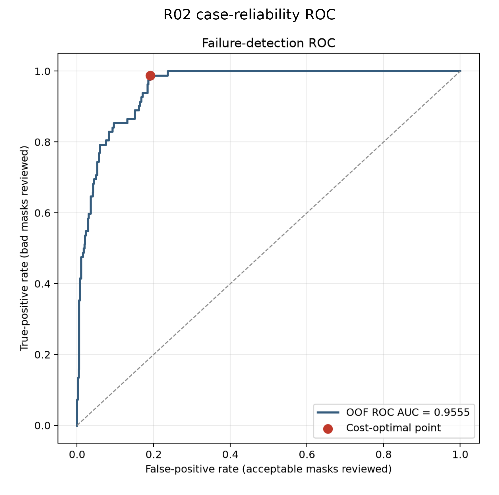

**Figure 5.** Case-level reliability ROC on 680 out-of-fold internal validation scores. Source: [P02 ROC artifact](../experiments/p02_threshold_selection/artifacts/roc_curve.png) and [R02 result](../experiments/r02_reduced_features/result.json).

Boundary entropy was the dominant feature. R01’s held-out permutation analysis assigned it a mean AUROC decrease of 0.2650 with CI 0.2404–0.2898. High-confidence foreground fraction was negatively associated with reliability in the earlier model, operationalizing the observation that some failures are confidently wrong. The final model remains associative: it indicates patterns correlated with overlap failure, not mechanisms that cause failure.

R12 tested whether R02 added value over two frozen one-feature comparators fitted only on BRISC development data. R02 exceeded predicted-area-only logistic regression by +0.0195 AUROC on OpenNeuro and +0.0085 on UPENN, and exceeded max-predicted-probability logistic regression by +0.0263 and +0.0445 respectively. Only the last comparison cleared the registered +0.03 margin. H11 therefore failed: R02’s external ranking is real on these cohorts, but the study did not show a consistent large advantage over simple predictors. [R12 result](../experiments/r12_r02_external_baselines/result.json)

### 6.7 Reliability policy

At the exact threshold 0.9490250173235835, 195/680 cases are flagged and 485 accepted. The policy catches 81 failures and misses one, for expected cost 205 under the registered weights. A conventional threshold of 0.50 flags only 66, catches 48, misses 34, and costs 406. Flagging nothing costs 820; flagging everything costs 680. The selected threshold therefore halves cost relative to 0.50 on this exact internal dataset and cost model. [P02 result](../experiments/p02_threshold_selection/result.json)

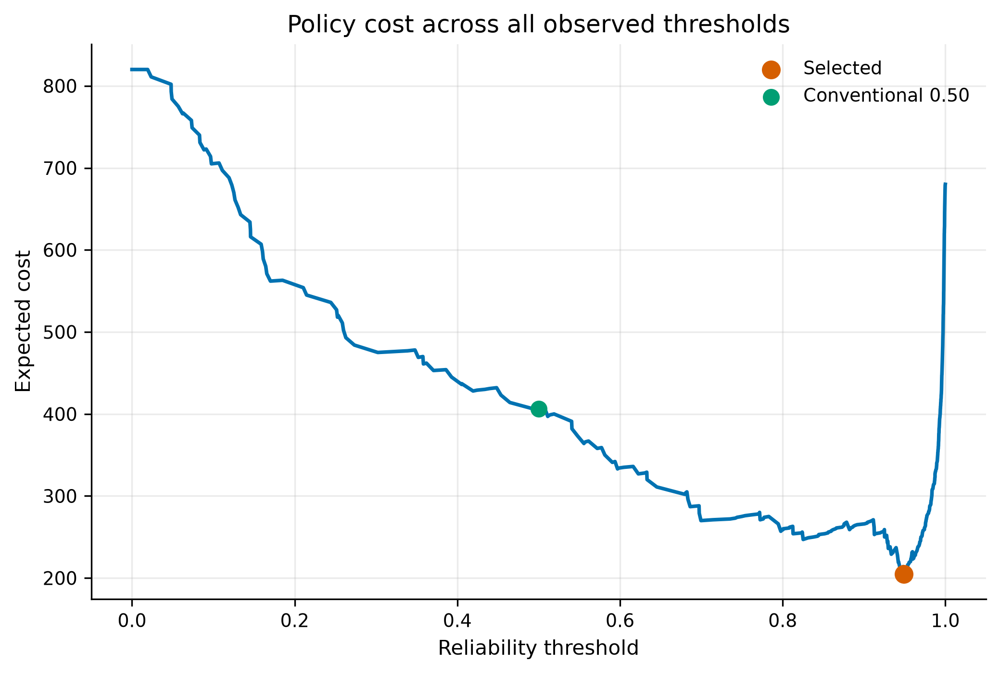

**Figure 13.** Expected cost across observed reliability thresholds. The selected internal operating point is compared with 0.50. Source: [P02 threshold curve](../experiments/p02_threshold_selection/artifacts/binary_threshold_curve.csv).

This apparent precision should not be confused with robustness. P05 classified the threshold as fragile. Within ±0.05, worst-case cost rose to 628; within ±0.10 it rose to 680. The full-precision value is frozen to reproduce the experiment, but it must be re-estimated under a new population or cost structure. [P05 result](../experiments/p05_threshold_sensitivity/result.json)

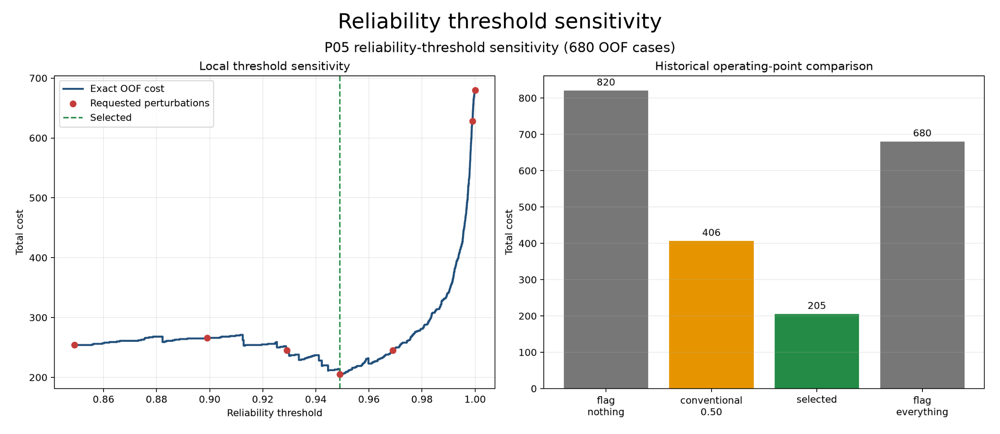

**Figure 11.** P05 threshold sensitivity. The local cost surface is not uniformly flat, so application code must preserve the registered value exactly. Source: [P05 artifact](../experiments/p05_threshold_sensitivity/artifacts/sensitivity_curve.png).

### 6.8 External transport

External segmentation transport failed. OpenNeuro strict subject-macro Dice was 0.1272 (CI 0.0824–0.1778). UPENN-GBM strict subject-macro Dice was 0.2208 (CI 0.2004–0.2422). Restoring predictions to native resolution produced nearly identical cohort means, so the unrepresentable 128×128 targets do not explain the broad failure. X01 overlap-control glioma Dice was 0.4142, while meningioma and pituitary performed better, consistent with source overlap and category dependence.

Failure ranking retained discrimination on the two evaluated independent cohorts, but calibration did not: OpenNeuro failure-detection AUROC was 0.8719 (CI 0.8112–0.9162) with ECE 0.2551, and UPENN-GBM AUROC was 0.8316 (CI 0.8120–0.8501) with ECE 0.3391. The internal threshold sent 90.6% of OpenNeuro and 82.5% of UPENN cases to review. R02 therefore preserved some ordering on X02 and X03 but not a validated external probability or operating point. R12 further showed that R02 did not consistently beat simple BRISC-fitted one-feature comparators by its preregistered margin.

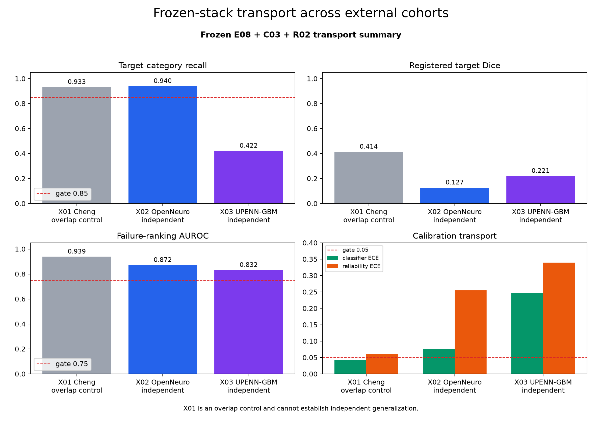

**Figure 7.** Frozen-stack transport summary. Independent spatial performance failed the registered gates, while overlap-control evidence is kept separate. Source: [X05 synthesis](../experiments/x05_cross_dataset_synthesis/result.json).

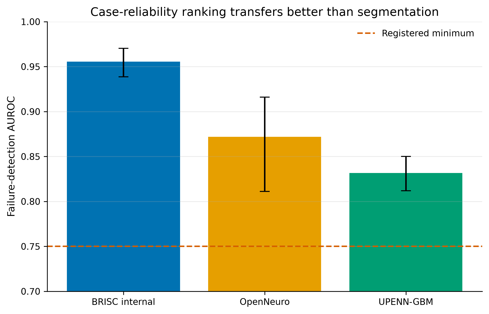

**Figure 14.** R02 failure-ranking AUROC remained above the registered 0.75 reference on both independent cohorts even as Dice collapsed, but calibration did not transfer: OpenNeuro AUROC 0.8719 with ECE 0.2551; UPENN AUROC 0.8316 with ECE 0.3391. Error bars are registered bootstrap intervals. Source: [R02](../experiments/r02_reduced_features/result.json), [X02](../experiments/x02_openneuro_pituitary/result.json), and [X03](../experiments/x03_upenn_gbm/result.json).

### 6.9 OOD detection and policy

O05 achieved AUROC 0.9957 with 95% CI 0.9927–0.9980, ECE 0.0341, and Brier score 0.0290 on 1,380 held-out benchmark images. The selected secondary logistic model improved AUROC over the equal-weight ensemble by 0.02455 with paired CI 0.01691–0.03309, clearing the registered selection rule.

At the O06 threshold, 699/700 registered OOD evaluation images were flagged: 99/100 Cheng and 100/100 for each of OpenNeuro, UPENN-GBM, OrganAMNIST, CIFAR-10, random noise, and uniform gray. Sixty of 680 BRISC validation images were also flagged, a false-flag rate of 8.82%. REFUSE remained disabled.

These results support OOD review on the registered benchmark. They do not establish universal OOD recognition. O02’s coefficient dominates the ensemble and can exploit differences in encoding, file size, contrast, and acquisition. A future in-distribution source with different encoding could be flagged, while a subtly shifted source that mimics BRISC statistics might pass.

O07 tested whether O05 also identified individual spatial failures inside the two external cohorts. Its failure-detection AUROC was only 0.5998 on OpenNeuro and 0.5638 on UPENN; highest-OOD-score quintiles captured about one fifth of failures, close to their 20% size. O05 is therefore a source-shift gate, not a reliable per-mask failure score. P06 then applied O06 and R02 jointly without changing either threshold. It retained 450/680 BRISC cases in `STANDARD` with one failure among them, but sent every OpenNeuro and every UPENN case to review. The frozen policy prevented evaluated external masks from entering the standard path by total abstention, yielding zero external standard-display coverage rather than demonstrated selective safety. [O07 result](../experiments/o07_ood_failure_correlation/result.json) [P06 result](../experiments/p06_joint_policy_risk_coverage/result.json)

### 6.10 Frozen stack reproducibility

The final package contains 31 allowlisted artifacts plus its manifest and totals 52,100,071 bytes. All copied source hashes matched. O02, O03, and O05 reconstructed registered scores within 1e-12. Three synthetic fixtures reproduced outputs twice within 1e-12, and strict allowlisting found no unexpected file.

The first staging attempt created an unlisted Python bytecode cache when importing the copied runtime and correctly failed before promotion. Bytecode writing was prohibited inside the package, the staging directory was rebuilt, and verification passed. This event is retained in the Stage 8 report because reproducibility includes operational file behavior, not only model weights.

## 7. What we learned that we did not expect

### 7.1 Failure ranking retained discrimination on two cohorts when segmentation did not

The strongest unexpected result was the separation between spatial performance and failure ranking. OpenNeuro Dice was 0.127 while reliability AUROC was 0.872 and ECE was 0.255. UPENN-GBM Dice was 0.221 while reliability AUROC was 0.832 and ECE was 0.339. The model often failed to draw the right mask, yet prediction-derived geometry and uncertainty still ranked many failures above better cases.

This does not make the external outputs safe. The finding is narrow: relative ordering remained informative on X02 and X03 even though absolute overlap and probability calibration were poor. R12 also found that R02 did not consistently outperform simple one-feature baselines by +0.03 AUROC. The observation may motivate prospective triage research, but it does not validate the masks or establish broader transfer.

### 7.2 Small-mask sensitivity was more predictive than the expected anatomical labels

The literature and initial visual review suggested diffuse boundaries, multifocality, or location might dominate glioma failure. Small target area is the strongest observed association in this model and dataset. Because Dice is mathematically coupled to object size, this is partly a metric artifact and is not a causal claim. That result fits the 128×128 design: small objects have fewer pixels, quantized edges, more volatile overlap, and greater vulnerability to a one-pixel shift.

R11 showed why the qualification matters: E08’s surface-Dice gain had a confidence interval crossing zero, while HD95 improved clearly and lesion-detection sensitivity changed little. The conclusion is model- and dataset-specific and combines a direct risk association with complementary metrics; it does not establish that target size causes failure.

### 7.3 The adapter has a countable small-target limit

The frozen 128×128 adapter erased five OpenNeuro targets and 82 UPENN targets. The fail-closed audits stopped when this first appeared, recorded identifiers and source target sizes, and added strict, representable-only, and native-resolution views. This made the adapter limitation explicit instead of silently dropping difficult cases.

The native-resolution analyses showed that fixing only these erased masks would not rescue external transport. Still, the counts define a concrete engineering limit: at this input resolution and resize rule, some very small annotated targets are not representable. A future model intended for small lesions would need a preregistered higher-resolution or three-dimensional design.

### 7.4 A calculated threshold strongly outperformed a familiar default

The reliability threshold 0.9490 may look unusually high. Under the registered ten-to-one missed-failure cost, it achieved cost 205 compared with 406 at 0.50. The important lesson is not that 0.9490 is universally correct. It is that a threshold should follow an explicit objective and cost model rather than habit.

The companion sensitivity result prevents overconfidence: the threshold is fragile, and costs change sharply under larger perturbations. Both findings are needed. The selection is optimal for the observed internal scores and declared costs; it is not transportable without reevaluation.

### 7.5 A missing OOD artifact was exactly reconstructible

O03’s Ledoit–Wolf precision matrix was not originally serialized. Stage 8 recovered it deterministically from the frozen fitting embeddings. Recomputed squared Mahalanobis distances matched the registered vector with maximum absolute error 0.0, passing the 1e-12 requirement. This is a useful reproducibility result: a missing derived state can sometimes be recovered exactly when its inputs, algorithm, library behavior, and provenance are fixed.

The recovery would have been rejected if it diverged. It does not excuse incomplete serialization earlier in the project; it demonstrates why reconstruction gates and frozen embeddings matter.

## 8. Analysis

### 8.1 The classifier is not the bottleneck on BRISC internal validation

The classifier’s macro F1 is high and its class recalls are balanced enough for the initial dataset task. Most weak segmentations have the right category label. Improving classification by a small amount would not directly solve misplaced, fragmented, or empty masks. Future work aimed at spatial performance should therefore prioritize representation, resolution, context, and target definition rather than assuming classification error is the dominant cause.

The routing dependency still matters. E08 uses the classifier-predicted category to select E07 or v1 for its third component. A routing mistake can change the ensemble map. The present internal classifier makes this uncommon, but X03’s poor glioma recall shows that routing can become unreliable under domain shift.

### 8.2 Glioma is the systematic weakness

Glioma is weaker in v1 segmentation, E08 segmentation, R02 subgroup AUROC, C06 subgroup calibration, and external GBM transport. This convergence across tasks is stronger evidence than any single mean Dice. It suggests that the issue is not merely one loss function or one threshold.

At the same time, “glioma is hard” is too broad. The Stage 1 decomposition points specifically to small target area, with fragmentation and spatial mislocalization common among weak cases. Per-category reliability models, category indicators, and nonlinear estimators did not fix glioma ranking. The dataset may lack enough independent failure examples to learn a stable glioma-specific reliability rule. The final system therefore uses a global reliability model and includes a measured predicted-glioma caveat in user-facing copy.

### 8.3 Calibration helps probability interpretation, not localization

C03 substantially improves lesion-centered calibration while preserving the hard mask. That is the correct behavior for the registered calibration task. It also means Dice cannot improve. Calibration should be understood as changing how a score is interpreted, not where the model looks.

External calibration results reveal the limit. On independent data, C03 offered little improvement or worsened lesion ECE. A monotonic mapping learned on BRISC cannot compensate for a new image distribution, target definition, orientation, or acquisition protocol. The OOD gate is therefore placed before normal display, and external recalibration would require a new registered study.

### 8.4 Reliability is useful but conditional

R02 combines geometry and uncertainty into a strong internal failure ranking. On OpenNeuro its external AUROC was 0.8719 with ECE 0.2551; on UPENN its external AUROC was 0.8316 with ECE 0.3391. Some ranking structure survived these shifts, but probability honesty did not. R12 failed its conjunctive baseline gate because R02 exceeded both simple predictors by at least +0.03 AUROC in only one of four cohort/comparator checks.

This distinction guides application wording. The interface may display a reliability score and review status as research indicators. It must not say that a mask is “95% clinically correct” or “safe.” The score is learned from BRISC-derived overlap outcomes and its threshold encodes a specific internal cost model.

### 8.5 OOD detection flags a registered source-shift pathway

Stage 6 revealed severe external segmentation failure. Stage 7 then showed that the registered external sources are readily detected as OOD. This is useful because the application can avoid presenting them in the normal flow. OOD detection converts a silent failure into a visible review state for these sources.

The mitigation is retrospective and source-specific. O02’s dominance suggests the detector recognizes dataset style as much as semantic validity. O07 found weak per-case association between O05 score and spatial failure, and P06 showed that the joint policy reviewed every X02 and X03 case. For these cohorts the policy achieved protection through total abstention, not selective acceptance of reliable external masks. A robust deployment study would need scanner-, site-, protocol-, and artifact-specific cohorts collected after the detector is frozen.

### 8.6 Internal scores are not clinical scores

The project’s strongest internal metrics arise from a dataset assembled for machine-learning development. Patient independence is not verified, classes are visually and procedurally distinct, and the model may exploit source cues. The near-perfect tumor/no-tumor discrimination observed earlier in development was a warning that the internal task is easier than real screening.

The report therefore avoids the phrase “96% accurate tumor detector” as a standalone claim. Appropriate wording names the dataset, split, metric, and limitation: for example, “macro F1 0.9779 on BRISC internal development validation, with patient independence unverified.” The external failures support this cautious framing.

### 8.7 The value of failed experiments

Many sophisticated additions did not improve the final system. Morphology and connected components did not clear their gates. Glioma-weighted and boundary-aware retraining did not meet the parent improvement. Extended reliability features and nonlinear models were worse. Several calibration approaches were numerically attractive but operationally invalid. The independent transport hypothesis failed.

These results narrow the design space. They show that adding complexity is not automatically progress and that interpretability can win on both performance and simplicity. They also provide a reviewable path for a future researcher: new work can target the demonstrated bottlenecks instead of repeating undocumented attempts.

## 9. Limitations

### 9.1 No clinical validation

No radiologist-supervised prospective evaluation, diagnostic study, treatment study, or clinical workflow study was performed. The masks and labels were not compared with a hospital standard of care. The application copy explicitly states “Research prototype — not for clinical use.” Nothing in this report establishes safety, benefit, or effectiveness for patient care.

### 9.2 BRISC patient independence is unverified

Similarity grouping removes known or visually near-duplicate relations but is not a substitute for patient identifiers. The same person may contribute related slices across development partitions. Internal metrics may therefore be optimistic. The statement that the sealed BRISC test set remains unopened is a process commitment supported by path discipline, scripts, and the review log; it is not enforced by cryptographic or operating-system access control. Its supplied split would not by itself resolve patient independence.

### 9.3 Dataset-source shortcuts

BRISC aggregates upstream sources. Labels can correlate with acquisition style, crop, contrast, text, compression, or resolution. The classifier and OOD detector may exploit these signals. O02 explicitly uses image and encoding statistics and dominates O05. High discrimination can therefore reflect source separation rather than tumor biology.

### 9.4 Two-dimensional, low-resolution input

The segmenter operates on a single 128×128 slice. It lacks neighboring-slice context, volumetric continuity, multiple MRI sequences, physical spacing, and reliable orientation metadata. Five OpenNeuro and 82 UPENN targets disappeared under the frozen mask adapter. Volume, diameter in millimetres, depth beneath skull, and anatomical impact are outside the supported output.

### 9.5 Glioma performance remains weak

E08’s glioma Dice of 0.6324 is substantially lower than its other category means. Small target area is the strongest observed association in this model and dataset. Because Dice is mathematically coupled to object size, this is partly a metric artifact and is not a causal claim. R11’s surface-Dice interval crossed zero even though HD95 improved, and reliability AUROC remains weakest for glioma. None of the registered improvement experiments achieved the parent target.

### 9.6 External transport failed

H8 was rejected on OpenNeuro and UPENN-GBM. These cohorts differ from BRISC in acquisition, target construction, orientation, and population. UPENN’s GBM-to-glioma mapping is coarse, but the failure remains practically important: the frozen stack does not generalize spatially to these registered independent cohorts. No positive-control model was trained on an external subset, so neural-model weakness cannot be fully separated from protocol, preprocessing, or label-definition mismatch. Meningioma external transport remains unknown because X04 access was blocked.

### 9.7 Reliability probabilities do not transfer cleanly

OpenNeuro reliability AUROC was 0.8719 with ECE 0.2551, and UPENN reliability AUROC was 0.8316 with ECE 0.3391. R12 also failed the registered requirement to exceed both simple external baselines by at least +0.03 AUROC. The R02 score should be treated as an internal reliability estimate and an exploratory external ranking signal. The exact 0.9490 policy threshold is not externally validated.

### 9.8 Threshold fragility

The selected reliability threshold is sensitive to perturbation. This is partly expected when many scores cluster near a high operating point and missed failures are expensive. Application code must preserve full precision, while any new deployment setting must re-register costs and evaluate a new policy rather than rounding or tuning informally.

### 9.9 OOD benchmark limitations

The benchmark includes easy far-OOD images and external sources already studied earlier in the project. O05 may detect file and acquisition cues. O07 showed weak OOD-score discrimination of individual mask failures, and P06’s external result was total abstention with zero standard-display coverage. The study contains no positive-control cohort that both transports spatially and passes the OOD gate. O05 has not been tested prospectively on unseen hospitals, scanners, subtle corruptions, or adversarial inputs. REFUSE is disabled because its false-refusal condition failed.

### 9.10 Calibration limitations

C03 is non-parametric and flexible. Its operational map is fitted on all internal validation pixels, while reported metrics are out of fold. It preserves masks but cannot fix spatial errors. Its external calibration did not transport. Lesion-centered evaluation uses reference masks for analysis, even though the mapping itself does not use them at inference.

### 9.11 Confidence intervals are conditional

Bootstrap intervals describe resampling variability under the registered grouping structure. They do not include systematic annotation error, unknown patient duplication, unmeasured acquisition differences, model-selection uncertainty across the entire project, or future-site shift. Small subgroup failure counts, especially meningioma, make category-specific reliability estimates unstable.

### 9.12 Governance cannot remove all researcher degrees of freedom

Pre-registration, amendments, hashes, and review logs make choices auditable, but the project evolved over many stages. At the external-review cutoff it contained 49 experiment packages, including 33 numbered E/C/R/O packages. New hypotheses were registered after earlier results, and some later work was motivated by observed failure patterns. R02 feature reduction, O05 secondary-ensemble selection, P02 threshold selection, the post-H1 H7 pathway, and the glioma subgroup predictor search are exploratory or development model-selection analyses. No comparison against nnU-Net, a published BRISC baseline implementation, or another strong compute-matched segmenter was run. The report should not be read as a single untouched prospective protocol.

### 9.13 What would change my mind

The project states conditions that would require revising its conclusions:

- **External transport:** if the frozen or prospectively frozen stack passed the registered H8 gates on a new patient-independent cohort from an unseen source, the broad H8 rejection would need to be narrowed or revised.
- **Small-mask mechanism:** if a higher-resolution controlled model removed the small-mask risk difference while holding training data and evaluation fixed, the present conclusion that small-target sensitivity drives glioma failure would need revision.
- **Glioma weakness:** if a patient-independent evaluation showed glioma Dice and reliability AUROC comparable with the other categories, the claim that glioma is the systematic weakness would no longer hold for that setting.
- **Reliability ranking:** if new external cohorts produced AUROC near chance, the present observation would remain limited to X02 and X03 and would not support a broader transfer hypothesis.
- **Reliability calibration:** if a preregistered external calibration study produced low ECE and stable cost at the current threshold, the statement that the internal policy is not externally validated would change.
- **OOD value:** if an unseen hospital cohort passed O05 as in distribution while the segmenter failed badly, O05 would not be an adequate gate for that shift. Conversely, strong prospective OOD detection across diverse sites would strengthen the source-shift mitigation claim.
- **OOD shortcut concern:** if removing encoding and file-statistic cues preserved O05 performance on unseen sources, the concern that O02 relies on shortcuts would be reduced.
- **Patient leakage:** if reliable patient identifiers proved that all BRISC development groups were independent, the patient-independence limitation would be removed; if they revealed cross-split duplication, internal metrics would require recomputation.
- **Threshold policy:** if a different registered cost model or prevalence selected a materially different threshold, 0.9490250173235835 would cease to be the appropriate operating point for that use.
- **Clinical relevance:** only a prospective, clinician-reviewed study under an appropriate protocol could change the statement that this project is not validated for patient care.

The purpose of these statements is to make the conclusions falsifiable. A future favourable result should update the report; it should not be forced to agree with the current narrative.

## 10. Conclusion

The binding result is that the frozen pipeline did not transport spatially to the two evaluable independent cohorts. Within that boundary, the project built and froze a complete research pipeline for BRISC-style brain MRI classification, tumor segmentation, calibration, reliability estimation, OOD review, and policy display. Internally, classification was strong, E08 improved every segmentation category over v1, C03 improved lesion-centered probability calibration, R02 provided a well-calibrated internal failure ranking, and O05 separated the registered ID and OOD sources. The final stack is hash-verified and reconstructible.

The project also produced clear negative evidence. Glioma remained weak. Small target area is the strongest observed association in this model and dataset; because Dice is mathematically coupled to object size, this is partly a metric artifact and is not a causal claim. External spatial transport failed on OpenNeuro and UPENN-GBM. External reliability AUROC remained above chance while ECE was poor, the simple-baseline gate failed, and the joint policy achieved external protection only by reviewing every case. The policy threshold was fragile, and OOD performance may rely on dataset shortcuts. These findings are part of the result, not footnotes.

The appropriate final claim is modest: this is a rigorous undergraduate research prototype with an unusually complete audit trail. It demonstrates how to combine model training, failure analysis, calibration, reliability, OOD detection, cost-sensitive policy, external validation, and immutable freezing on accessible hardware. It does not demonstrate a medical device or a clinically valid tumor detector.

Future work should begin with patient-identified, multi-sequence, three-dimensional data; preserve native physical spacing; evaluate a higher-resolution small-lesion path; include prospective unseen sites; involve radiologists in annotation and review; and register clinical or workflow objectives before collecting outcomes. Until then, every output should remain in a research setting with the frozen warning: **Research prototype — not for clinical use.**

## 11. Verification and appendix

The detailed metric definitions are in [methods.md](methods.md). Consolidated limitations are in [limitations.md](limitations.md). Artifact hashes, amendments, experiment links, and the figure manifest are indexed in [appendix.md](appendix.md). The machine-readable [source ledger](stage9_source_ledger.json) records every headline metric and its committed evidence file.

Stage 9 changed documentation files only. The frozen Git tree for `runs/final_stack/` remains `439b4fca4b47f12b173c24eaa039b1258f9ddf03`, and its manifest SHA256 remains `7e67de9f16b183165cf0c065e98111cff318ef616630adf52108ce6a57cacf8a`. The freeze commit is `c2566214bb921c7185fc8949b3e0376492e7113e`.
